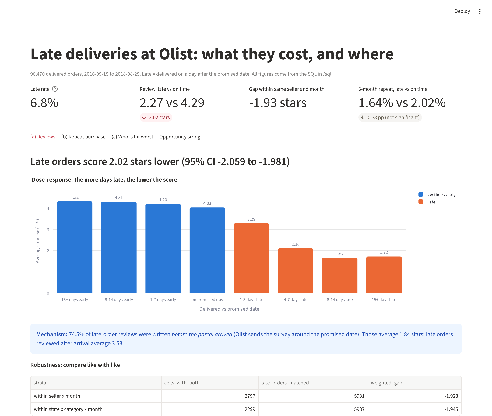

# Late deliveries at Olist: what they cost, and where

A product-analytics case study on the public [Olist Brazilian e-commerce dataset](https://www.kaggle.com/datasets/olistbr/brazilian-ecommerce)
(99,441 orders, Sep 2016 to Aug 2018). SQL in DuckDB, dashboard in Streamlit.



## Question
1. How much does a late delivery lower the review score?
2. Does a late first delivery lower repeat purchase within 6 months?
3. Which states, sellers and categories are hit worst?
4. If late deliveries fell in the worst segment, what would repeat rate, revenue and reviews do?

## Method
| Step | File |
|---|---|
| Load all 9 CSVs into DuckDB | `sql/00_load.sql` |
| One row per order: late flag, days late, latest review (window fn), payment value, main seller and category (most expensive item) | `sql/01_order_facts.sql` |
| Review impact: raw gap with 95% CI, dose-response by days late, stratified gap within seller x month and state x category x month, review-timing mechanism | `sql/02_review_impact.sql` |
| Repeat purchase: first-order cohort per `customer_unique_id`, 180-day window, censoring cut-off, CI, power, dose-response, stratified gap | `sql/03_repeat_purchase.sql` |
| Segments: states, categories, sellers, seller concentration, route, month, seller vs carrier | `sql/04_segments.sql` |
| Opportunity sizing for RJ with parameterised assumptions | `sql/05_opportunity.sql` |

**Definitions**
- *Delivered order:* `order_status = 'delivered'` with a delivery date (96,470 orders).
- *Late:* delivered on a calendar day after `order_estimated_delivery_date` (the date shown to the buyer).
- *Customer:* `customer_unique_id`. Olist issues a new `customer_id` per order, so using it would show 0% repeat.
- *Repeat within 6 months:* a non-canceled order on a later calendar day, within 180 days of the first order (same-day orders are a split basket). Cohort = people whose first order was delivered and who have a full 180 days of data before the data end (2018-08-29, the last day with 100+ orders). That keeps first orders from 2016-09-15 to 2018-02-22: 51,035 customers.
- *Hit worst:* "stars lost" = late orders with a review x (on-time avg - late avg) in that segment, plus late rate.

## Findings
**(a) Reviews: large, consistent, and dose-dependent.**
- Late orders average **2.27 stars vs 4.29** on time: -2.02 (95% CI -2.06 to -1.98). 62.4% of late orders get 1-2 stars vs 9.3%.
- Comparing only within the same seller and month: **-1.93**; within state x category x month: -1.95. Confounding by seller or season explains very little.
- Dose-response: 4.32 (15+ days early) -> 4.03 (on the day) -> 3.29 (1-3 days late) -> 2.10 (4-7) -> 1.67 (8-14).
- Mechanism: **74.5% of late-order reviews were written before the parcel arrived** (avg 1.84); late orders reviewed after arrival average 3.53.

**(b) Repeat purchase: directionally lower, not proven.**
- Only 1,021 of 51,035 cohort customers (2.0%) came back within 180 days.
- Repeat rate **1.64% after a late first order vs 2.02%** after on-time: -0.38 pp, 95% CI -0.89 to +0.13 (z = -1.47). Not significant.
- Counting only reorders placed after the first parcel arrived: -0.48 pp (CI -0.95 to -0.02), borderline.
- Stratified within state x month: -0.21 pp; within category x month: -0.33 pp.
- Power: with 2,563 late first orders the smallest drop we could reliably detect is **0.79 pp (40% relative)**. A real but smaller effect is entirely possible.

**(c) Who is hit worst**
- States by late rate (300+ orders): **AL 21.4%, MA 17.4%, SE 15.2%, PI 13.9%, CE 13.8%** vs SP 4.5%, PR 4.0%.
- By stars lost: **RJ #1** (12,350 orders, 12.1% late), then SP (sheer volume), MG, BA.
- Time: 48.3% of all late orders come from Nov-17, Feb-18 and Mar-18 (21.6% of orders). RJ ran 31.2% late in those months vs 6.6% otherwise.
- Carrier, not seller, is the main leg: late orders spent 27.9 days with the carrier vs 7.9 for on-time; sellers missed their hand-off deadline in 27.8% of late orders (7.7% of on-time).
- Sellers: the top 100 by late orders (of 2,959) hold 50.4% of late orders and 41.9% of orders. Worst single seller (100+ orders): 19.1% late.
- Categories vary much less (4.2% to 8.1% among categories with 500+ orders). Category is not the lever.

**(d) Opportunity (RJ, last 12 months: 9,345 orders, 9,215 new customers, R$1.55M GMV, 14.9% late)**

| Cut in RJ late rate | Late orders avoided / yr | 1-2 star reviews avoided / yr | RJ avg review | RJ repeat rate (mid) | Extra repeat revenue / yr (low-mid-high) |
|---|---|---|---|---|---|
| 3 pts | 280 | 149 | 3.89 -> 3.95 | 2.14% -> 2.15% | R$94 / R$169 / R$393 |
| 5 pts | 467 | 248 | 3.89 -> 3.99 | 2.14% -> 2.16% | R$156 / R$281 / R$656 |
| 10.4 pts (parity with SP) | 972 | 517 | 3.89 -> 4.09 | 2.14% -> 2.18% | R$325 / R$585 / R$1,364 |

The retention money is negligible because almost nobody reorders. **The business case is review quality**, which feeds seller ratings, search ranking and new-buyer conversion (not measurable in this dataset).

## Assumptions (sizing)
- A1 Measured gaps are causal and the same in RJ as nationally. (Review: plausible, see stratified and dose-response. Repeat: unproven.)
- A2 Cutting RJ's late rate by X points cuts the late rate of RJ first orders by X points.
- A3 Volume = last 12 full months (2017-09 to 2018-08), held flat.
- A4 Value of a repeat customer = R$160.22, the mean 180-day repeat spend per repeater.
- A5 Repeat effect per late first order: low -0.21 pp (stratified), mid -0.38 pp (raw), high -0.89 pp (CI bound).
- A6 No second-order effects (ratings -> conversion) counted.

## Correlation vs causation
Everything here is observational. Late orders differ from on-time ones (remote states, peak months, certain sellers).
What makes the **review** effect credible: it survives stratifying by seller x month (-1.93), it rises monotonically with days late, and there is a clear mechanism (reviews written before arrival).
What is **not** shown: that late delivery causes lower repeat purchase. Stronger designs:
- **Seller-matched / lane-matched comparisons** of customers who bought the same product from the same seller in the same week, one parcel late and one not.
- **Regression discontinuity** around the promised date: orders delivered 1 day early vs 1 day late are nearly identical except for "late".
- **Natural experiment:** the Feb-Mar 2018 spike hit some lanes and not others (difference-in-differences on repeat rate).
- **Randomised test** going forward: proactive delay message or voucher vs holdout on late orders.

## Roadmap
See [ROADMAP.md](ROADMAP.md): peak-season carrier capacity, review-after-delivery + delay messaging, top-100 late-seller program, lane-aware ETAs.

## How to run
```bash
pip install -r requirements.txt
./scripts/download_data.sh          # Kaggle CLI if configured, else public GitHub mirror
python scripts/run_sql.py           # builds data/olist.duckdb, runs sql/*.sql, writes results/*.csv
streamlit run app.py
```
Or query directly: `duckdb data/olist.duckdb` after the build.

**Data source note.** Kaggle was not reachable from the build environment, so the CSVs came from a public
GitHub mirror (`alaa-github/Olist_Dataset`). File sizes and row counts match the Kaggle release (99,441
orders, 112,650 items, 99,224 reviews), and the reviews file is byte-identical (MD5) to a second independent mirror.
